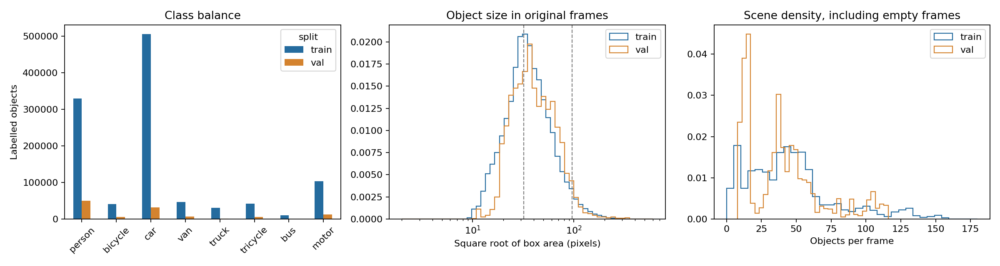
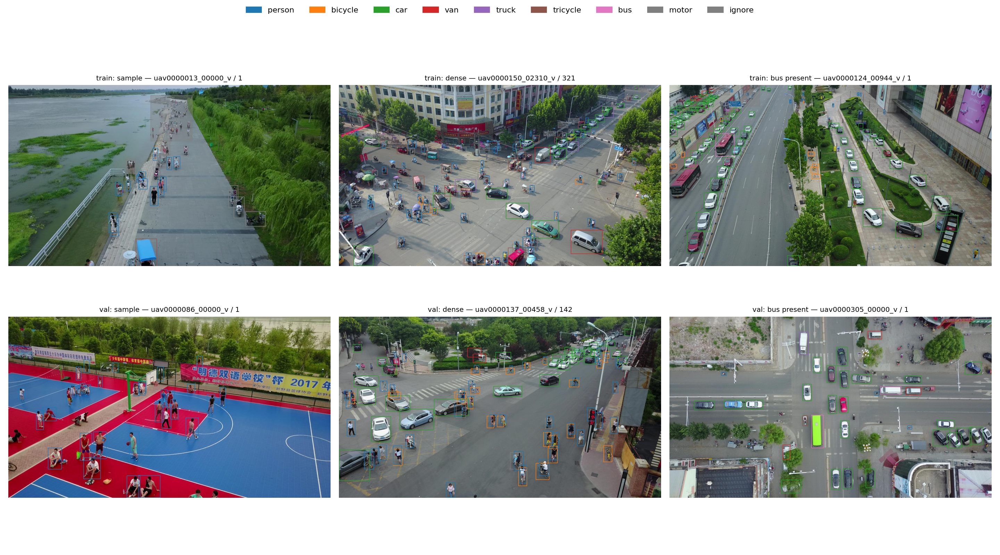
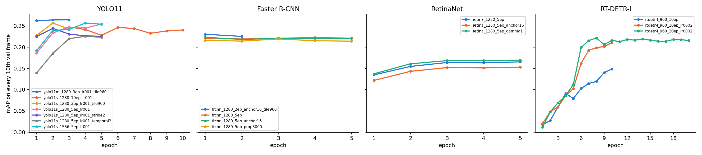

## Introduction

1. ### EDA
   
Перед початком всього я пішов із агентом до даних. Передивився декілька фреймів із різниз відосів із VisDrone та запустив декілька скриптів, щоб зрозуміти глобальну картину датасету. З основного що дізнався, і що памʼятаю на момент написаня репорту: `car` та `person` класи разом 70+% від всіх лейблів. Звідси є розуміння, що на класах які більш рідкісні буде гірша точність (бо моделька гірше натренується) і їх AP буде тягнути mAP до низу. 

На кадраз із розмірністю 1280px медіанний розмір боксу близько 50px, що означає, що small objects detection буде метою. Тому, в своєму пайплайні я грався із великою якістю зображень, щоб зберегти точність + в останніх експерементах зменшив anchor моделькі r-cnn до 16px із 32. але про це пізніше.
Також на етапі EDA я дивився до нічних кадрів, але здається як датасет по цьому принципу нормально розподілений і що в трейні що в тесті мало ночей

2. ### Setup
**Kaggle**: всі тренувальні експеременти на kaggle notebooks. Використав два безкоштовних тижні на T4 Gpu.
**Mac air m2**: локально запускалась тільки EDA, evaluation, і ансамбль модельок для фінального пайплайну.
**Tech**: всі моделькі стартують із coco pretrained weights. Для всіз запусків однаковий сетап, seed 42, requirements.txt

## Method

Спершу пройдусь по обовʼязкових експерементах, їх конфігураціях та результатах. Потім розкажу за свій пайплайн.

1. ### Two-stage, anchor-based: Faster R-CNN
**Конфігурація:**
- моделька ResNet-50 FPN v2
- брав кожен пʼятий фрейм із кожного відео в якості 1280 px
- запускав на 5 epochs
- batch 4 із SGD та learning rate = 0.005 + cosine schedule

в мене було декілька експерементів: 

| варіант | val mAP | AP50 | AP_small |
|---|---|---|---|
| baseline (anchor 32, 1000 proposals) | **0.2252** | 0.450 | 0.106 |
| anchor 16 | 0.2225 | **0.467** | 0.107 |
| 3000 proposals | 0.2169 | 0.454 | 0.110 |

- В кінці експерементував із розміром anchor (be default найменший був 32px) я зменшив до 16, думав збільшиться recall на малих обʼєктах і можливо це вплине на кількість коректно вгаданих. Але вплинуло власне тільки на recall, через що AP50 піднявся але mAP не змінився.
- Більше proposals не допомогло і вдвічі сповільнило inference.
- Як окрема модель Faster R-CNN трохи слабша за YOLO, але all-in-all я її використав в кінцевому ансамблі.

2. ### One-stage, anchor-based: RetinaNet
Конфігурація: той самий backbone, 1280 px, 5 epochs, SGD але lr 0.0025

| варіант | val mAP | AP_small |
|---|---|---|
| baseline (focal loss γ=2) | 0.1645 | 0.059 |
| anchor 16 | 0.1520 | 0.058 |
| γ = 1 | **0.1688** | 0.062 |

Найслабша модель зі всіх. особливо на малих обʼєктах. Похожу two-stage із RoI це тєма

3. ### Anchor-free: YOLO11
Конфігурація: YOLO11s, SGD cosine, + добавив mosaic із автоматичним вимкненням за 1 епоху до кінця. 
mosaic це метод data augmentation для yolo, коли ми робимо мозаїки (колажі) із різних фреймів із датасету. моделька так вчиться на значно менших обʼєктах, бо ми втискаємо 4 зображення в одне. Також це мало б покращити генералізацію, бо обʼєкти зʼявлялись у нетиповому для себе середовищах.

по результатах:

| запуск | val mAP | public LB | що змінив |
|---|---|---|---|
| 640 px, 3 ep, lr 0.01 | 0.1668* | 0.1909 | перший сабміт |
| 1280 px, 20 ep, lr 0.01 | 0.1958 | 0.1865 | більша роздільність; досягли піку вже на 1-й епосі |
| **1280 px, 5 ep, lr 0.001** | **0.2327** | **0.2470** | у 10 разів менший lr |
| 1536 px, 5 ep | 0.2430 | 0.2342 | ще більша роздільність (не виправдана трата) |
| 1280 px, 10 ep | 0.2303 | — | більше епох не допомогло |
| 1280 px, stride 2 (12k кадрів) | 0.2265 | — | більше кадрів не допомогло (вони по суті дублікати) |

- Експерементальним шляхом встановив що lr 0.01 занадто великий, тому зразу почав опускати його. 
- 1536px краща на val але гірша на лідерборді. Я знав, що краще судити по val, тому памʼятав про цю модельку і потім її ще використаю

4. ### Query-based: RT-DETR-l
Конфігурація: 960 px, AdamW

| запуск | val mAP |
|---|---|
| lr 1e-4, 10 ep | 0.1253 |
| lr 2e-4, 10 ep | 0.1732 |
| lr 2e-4, 20 ep | **0.1905**|

- Трансформери тренуються повільно і хочуть епох. Я мав ліміти по GPU квотах на каглі, тому різав експеременти на трансормерах в першу чергу.
- В модельки був ліміт на 300 queries на фрейм, тут це проблемою не було, бо в датасеті фрейм мав найбільше 180 обʼєктів. Але це треба враховувати.

5. ### Comparison 

| модель | найкращий val mAP | AP_small | ms/кадр (T4, batch 1) |
|---|---|---|---|
| YOLO11s 1536 | 0.2430 | 0.121 | 15.0 |
| Faster R-CNN | 0.2252 | 0.106 | 69.5 |
| RT-DETR-l | 0.1905 | 0.089 | 54.2 |
| RetinaNet | 0.1688 | 0.062 | 53.0 |

6. ## My Pipeline

### 6.1 Ensemble: Weighted Boxes Fusion (WBF)
З обов'язкових моделей найкращими були **YOLO11** і **Faster R-CNN**. Вони з різних сімейств (one-stage anchor-free і two-stage anchor-based), того роблять різні помилки, і в ансамблі ці помилки частково компенсуються.

Для поєднання я юзав WBF - він усереднює координати боксів від різних моделей, зважено за впевненістю. А NMS просто викидає слабші бокси, що менш прикольно.

| ансамбль | val mAP | public LB |
|---|---|---|
| YOLO 1280 + YOLO 1536 | 0.2583 | |
| YOLO 1280 + Faster R-CNN | 0.2572 | |
| 2 YOLO + Faster R-CNN (fusion IoU 0.6 / **0.7** / 0.8) | 0.2643 / **0.2711** / 0.2678 | |
| **2 YOLO + 2 Faster R-CNN** | **0.2726** | **0.2684** |
| + RetinaNet | 0.2711 | |
| + RT-DETR | 0.2725 | |

Додавання RetinaNet і RT-DETR не допомогло: вони слабші і нового не приносять.

### 6.2 Tiling
Фрейми у датасеті зберігаються в різних роздільностях, а моделька приймає все в одному розмірі (1280), через що часто втрачались корисні пікселі. Тому я вирішив погратись із тайлингом.
Великі зображення будуть розділятись на тайли із overlap та надсилатись до модельки окремо. 
Ідея в тому, що обʼєкт залишається у своєму справжньому розмірі (або збільшується) і модельці легше його знайти і взагалі вона більш точна мала б бути.

| модель | val mAP | AP_small | ms/кадр |
|---|---|---|---|
| YOLO11s tile (тільки весь кадр на inference) | 0.2394 | 0.106 | |
| **YOLO11s tile** (кадр + crops) | 0.2657 | **0.155** | 259 |
| YOLO11m tile | 0.2676 | 0.148 | 475 |
| Faster R-CNN anchor16 tile | 0.2499 | 0.123 | 858 |

Tiling дав найбільший приріст на малих об'єктах (AP_small 0.106 → 0.155). 
Але inference у +- 17 разів повільніший

| ансамбль (×2 = вага 2 у WBF) | val mAP | public LB |
|---|---|---|
| tile s ×2 + 2 YOLO + 2 FRCNN | 0.2895 | 0.2767 |
| 5 folds tile s + tile s + 2 YOLO + 2 FRCNN | 0.2887 | 0.2805 |
| tile s ×2 + tile m ×2 + 2 YOLO + 2 FRCNN | 0.3024 | 0.2889 |
| + tile FRCNN ×2 | 0.3082 | |

tile s = tile YOLO11s trained with tiling
tile m = tile YOLO11m trained with tiling
2 YOLO = YOLO11s at 1280 px   +   YOLO11s at 1536 px;
2 FRCNN = Faster R-CNN    +    Faster R-CNN anchor16

Також я вкінці вирішив обʼєднати `train` та `val` і натренувати модель tiled YOLO11s на всьому датасеті, щоб краще генералізувалась і можливо отримати кращий скор на лідерборді. Використовував **5 folds**.

### 6.3 Temporal

Це було у самому кінці і відчутного результату не дало, хоча й 6.3.3 є в одному із моїх фінальних рішень.
Не вважаю це за контрібʼюшн для додаткового.
Але все одно розкажу за ці три експеременти:

#### 6.3.1 Temporal input
Замість стандартних трьох R G B каналів я згодовував модельці 3 grayscale канали в яких були: (t-2, t, t+2) - де t це теперішній кадр. в такому разі моделька бачитиме не кольорові залежності, а сам рух обʼєктів між кадрами.
Результат - тільки погіршився (0.2327 -> 0.2075)

#### 6.3.2 Fusion across frames
Брав запропоновані бокси на t, t-1 та t+1 фреймах та робив на них WBF. 
Працювало також погано, і тільки погіршило результат. Причина полягає в русі обʼєктів на фото.
Умовно машина яка порухалась на 20px отримує усереднений бокс, і фітиться ні до теперішнього кадру ні до попереднього.

#### 6.3.3 Temporal rescoring
Цей степ вирішує попередню проблему. Ми не усереднюємо бокси, а тільки дивимось на те чи зʼявляється обʼєкт в сусідніх фреймах і якщо так - тоді confidence сусідніх фреймів впливає на конфіденс на поточному
Значного бусту на val це не дало (+0.0016), а от на лідерборді 0.2889 -> 0.2921

## Results (BEST RESULT)

Фінальна модель це ансамбль із 7 моделей:

- tiled YOLO11s      ×2
- tiled YOLO11m      ×2
- tiled Faster R-CNN ×2
- YOLO11s 1280
- YOLO11s 1536
- Faster R-CNN
- Faster R-CNN anchor16

WBF (IoU 0.7) (temporal rescoring k=2, a=0.2.)

|метрика|значення|
|---|---|
|val mAP | 0.3098|
|AP50 | 0.574|
|AP_small | 0.182 |

**public LB 0.30730** **35/76**
**private LB 0.2903** **10/76**  +25pts

## Conclusion

Гарна домашка. Я знову гарно генералізувався на private (попереднього разу дав +20, зараз +25)
Міг ще погратись із трансформерами більше. був би не соло в команді а ще з кимось то мав би х2 компʼюту на кагл і був би на то час. Крім того можна було б ще просто напросто більші моделі використати. Або за необмеженого компʼюту all in і тренувати всі фрейми на максимальній роздільній здатності і робити висновки вже потому
